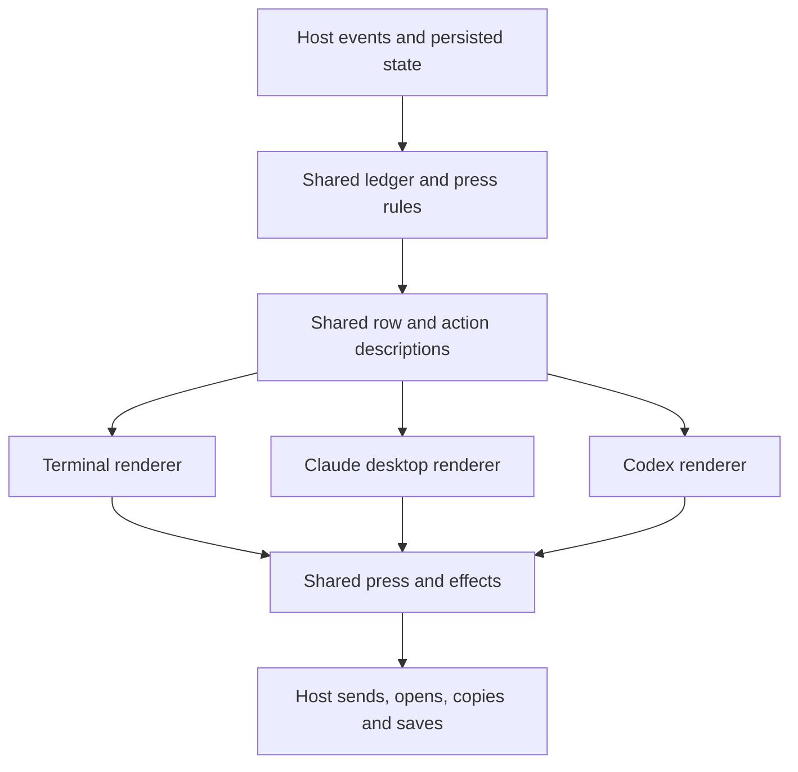

# Platform architecture assessment

Status: proposed. Assessment complete; implementation recommendations remain proposed.

Reviewed on 2026-10-13 against published [v0.2.3](https://github.com/petekp/inbox/releases/tag/v0.2.3)
at `535a705`. The release tag, remote main and local HEAD resolve to the same
commit. The release comparison covers changes since the audit's `5f1c1fa` baseline.

Keep one shared description of the inbox's behavior and content, with native
renderers for each look. Extend the existing row and action models. Keep
platform measurement, controls, focus and motion in their adapters.

The release advances this direction by sharing default selection, keeping
the current row open, and choosing the next waiting row after a close. The
remaining weakness is incomplete ownership: adapters and hosts still make
decisions that affect the same product behavior. Several copies disagree.
Active instructions also contain obsolete steps, and the checks do not
catch all the differences.

A **look** is the terminal, Claude desktop pane or Codex tab. A **host** runs
the plugin: the Claude mod serves two looks, and the Codex plugin serves one.
These terms follow [the glossary](../../GLOSSARY.md).

The implementation sequence should account for work already shipped:

| Area | Current release | Effect on the plan |
| --- | --- | --- |
| Selection | `firstWaiting`, `keptOpen`, `rowAfterClose` and `listWaits` are shared in `hooks/view.ts`; `prRowWaits` adds PR row state. Both hosts consume them. | Reuse these owners. Narrow the remaining selection work to host integration and the duplicated empty-tab rule. |
| Finished plans | Completed revamp handoffs and the plan archive are removed. The primary-button entry in the look map is corrected. | Remove those cleanup tasks. Reconcile the remaining active instructions. |
| Arrivals | New rows have no colored arrival bar. Arrivals above the current row preserve it. A successful close or handoff opens the next waiting row. | Preserve these product decisions during extraction and add interaction checks around them. |
| Terminal fitting | Inline scrolling targets the open row and repeats after resize. Short panes clip finding detail to leave room for actions. | Keep measurement and scroll execution in the terminal adapter. |

The four reproduced host defects remain. Documentation cleanup is partly
complete; the remaining guidance contradictions are listed below. Action-order
drift, import-gate gaps and renderer coverage gaps also remain.

## Findings

Findings 1–8 are confirmed with high confidence within the evidence described.
The lock probe confirms overlapping holders; production data loss remains a
timing risk, not an observed incident. File locations refer to the reviewed commit.

1. **High · Reliability: a live state writer can lose its lock.**

   The Codex state lock expires after 15 seconds based only on its directory's
   age. Its release also removes the directory without checking ownership.
   A disposable probe aged a lock while its first holder remained active.
   A second holder entered before the first released it.

   The server holds this lock while waiting for a queue command whose timeout
   is also 15 seconds. A slow send can therefore expose concurrent state
   writes and lost updates. A longer expiration would retain the same flaw.
   Use ownership-aware acquisition, recovery and release. Verify two writers
   preserve both updates, and that an old owner cannot release a new lock.

   Evidence: `codex/src/state.ts:211–239`, `codex/src/server.ts:190–195` and
   `codex/src/server.ts:340–364`. The existing update-process lock is a useful
   comparison, but its recovery protocol also needs review before reuse.

2. **Medium · Bug: a failed Codex update keeps displaying Updating.**

   The first failed model call leaves a failed exchange pending for the next
   update trigger. The worker exits and clears its running flag. The view
   nevertheless treats any pending exchange as running, which hides the error.

   The isolated probe returned a stopped worker, one failed pending exchange,
   and view status `{ isUpdating: true, error: null }`. Polling does not retry
   that exchange. Another Stop event can trigger the retry.

   Define update status from active work and retry state explicitly. Keep the
   host responsible for scheduling the retry. Extend the existing update
   coverage through the resulting view so a retained failure cannot appear
   to be running indefinitely.

   Evidence: `codex/src/update.ts:108–118`, `codex/src/update.ts:178–203`,
   `codex/src/core.ts:247–265`, `hooks/view.ts:776–779` and
   `codex/tests/update.spec.ts:19–51`.

3. **Medium · Bug: a bulk PR action arrives only on its parent row.**

   Address all records a queued action on the PR block and its review threads.
   Codex acknowledges only the row recorded on the sent message. After prompt
   arrival and reply completion, the probe showed the PR block as addressed
   while both threads still said Queued.

   The shared `withArrival` function acknowledges every matching action, and
   the mod already uses it. Use that existing function in Codex. Verify bulk
   delivery, repeated messages and a newer press on one of the affected rows.

   Evidence: `hooks/pr-tab.ts:337–347`, `codex/src/core.ts:54–62`,
   `hooks/presses.ts:430–440` and `hooks/register.tsx:2717`. Current Codex
   integration coverage exercises individual rows and threads, not this bulk outcome.

4. **Medium · Bug: Codex omits PR-opening help from Needs you.**

   The mod adds an Open PR step when a question refers to a tracked PR.
   Codex supplies empty extra steps to both view construction and press
   validation. A synthetic question about merging a linked PR produced the
   step in the mod view and none in Codex. Submitting that same step to the
   Codex server returned stale.

   Share the existing tracked-PR step computation and use it when drawing
   and validating presses. Cover linked PRs, the branch PR and duplicate
   explicit links. This is an input gap around an existing shared function.

   Evidence: `hooks/register.tsx:945`, `hooks/register.tsx:2006`,
   `hooks/register.tsx:2132–2137`, `codex/src/core.ts:262` and
   `codex/src/server.ts:234`.

5. **Medium · Design flaw: desktop overrides the shared action order.**

   The shared key plan puts retry first, then options or help steps, then
   Done or the finding action. Desktop promotes main actions ahead of the
   others. Codex preserves the shared order. A task can therefore offer Done
   before its help on desktop, and a failed send can put its main action
   before Try again. The differences table does not explain this choice.

   Make retry priority and action order shared decisions. Keep button styling
   local. If desktop needs a different order, name that policy and its reason
   in the shared presentation function and the current look map.

   Evidence: `hooks/view.ts:rowKeyPlan`, `hooks/register.tsx:3380–3383` and
   `codex/src/tab.tsx:Panel`. This is a source-confirmed order difference;
   current desktop painting was not observed.

6. **Medium · Stale docs: agents can follow a plan that contradicts the shipped system.**

   The active three-looks plan still proposes making PR logic Claude-only
   because Codex has no PRs. Codex consumes the shared PR module. That plan
   also asks for default-selection extraction now supplied by the shared
   selection helpers, and still describes already-fixed primary-button drift.

   The current UI spec forbids opening another row automatically after a
   press. The release does so. The look map and glossary still describe a
   new-row bar that the release removed. These contradictions can cause an
   agent to reverse the new behavior while following the stated rules.

   The planned failed-update policy also needs correction. It says the mod
   keeps `turnsApplied` on failure, but the mod advances it after a failed
   exchange or catch-up. Codex advances it after a second failure. Shared
   update work must distinguish reply completion, active work and deferred
   retry from those current transitions.

   The narrow desktop age rule is also inconsistent. The map says ages disappear
   below 50 columns, while the current row Client always receives an age and
   reserves side space. This establishes a code/document contradiction, not
   a measured clipping defect.

   Reconcile the existing map, glossary, UI spec and remaining plan against
   current source. Keep outstanding live checks explicit.
   Correct the desktop age contract or implement the intended rule after
   deciding which behavior is wanted.

   Evidence: `docs/plans/three-looks.md:155–170`,
   `docs/plans/inbox-ui.md:477`, `docs/looks.md:95–107`, `GLOSSARY.md:47–49`,
   `hooks/register.tsx:1072–1080`, `hooks/register.tsx:rowClientProps`,
   `hooks/view.ts:531–560` and `codex/src/update.ts:108–141`.

7. **Medium · Design flaw: the import gate misses prohibited dependencies.**

   Disposable fixtures ran the actual structure checker. Canonical forbidden
   imports failed, but equivalent extension-bearing imports, dynamic imports
   and imports from nested Codex directories passed. The gate also omits
   `hooks/tones.ts`, although both hosts consume its values.

   Extend the existing gate to resolve import targets, recurse through source
   directories and include build-time shared modules. A small set of subprocess
   fixtures should prove both allowed imports and forbidden forms. The owner
   symbol check currently proves only that a word occurs somewhere in a file;
   it cannot establish semantic ownership or documentation freshness.

   Evidence: `scripts/check-structure.mjs:18–58`,
   `scripts/check-structure.mjs:118–124` and `codex/build.mjs:82–105`.

8. **Medium · Reliability: the Codex renderer is outside automated coverage.**

   Codex tests exercise the shared view, server and motion reducer. They do
   not mount the tab. A missing button, broken reply field or incorrect DOM
   measurement can pass those checks. The mod's demo drawing test covers
   terminal and desktop content, but filters settled rows and omits PRs.

   Separate Codex page effects from components enough to test real drawing
   and interactions. Extend existing mod coverage only for distinct missing
   contracts. Keep shared reducer tests in their current owner; repeating
   them for each look does not test adapter wiring.

   Evidence: `codex/tests/press.spec.ts:1–19`,
   `codex/tests/press.spec.ts:595–638`, `tests/hooks.test.ts:2161–2250` and
   `docs/plans/three-looks.md:149–153`. This gap is already planned work.

**Needs follow-up · Medium · Reliability: subagent event admission.** A
synthetic hook payload with `agent_id` changes the parent's turn count and
prompt text before the subagent check runs. The existing test checks only
hook diagnostics. Actual delivery of this payload remains unknown in the
platform reference. First verify the host event, then define admission before
state mutation. Confidence is high for the conditional code path and low for
production reachability. Evidence: `codex/src/hook.ts:61–65`,
`codex/tests/hook.spec.ts:83–85` and `docs/reference/codex-plugins.md:1839`.

## Recommended architecture and sequence

The following is the proposed ownership split. Much of it already exists.

| Concern | Shared owner | What stays platform-specific | Reason |
| --- | --- | --- | --- |
| Product outcomes | Ledger, press and PR modules | Storage and transport execution | An answer, handoff or Undo should mean the same thing in both hosts. |
| Row content and actions | Extend `RowView`, `ActionView` and existing view helpers | Mapping to native widgets | Title, feedback, available actions, order and emphasis should have one decision point. |
| Selection and arrivals | Existing shared selection helpers; consolidate the remaining empty-tab rule | Scrolling, focus and event scheduling | The chosen row is product behavior; making it visible depends on the host. |
| Layout | Shared hierarchy and deliberately shared dimensions | Units, wrapping, breakpoints and measurement | Terminal cells, desktop proportional text and browser layout fit content differently. |
| Color and icons | Meaning of each tone and mark | Host theme resolution, glyphs, SVG and contrast checks | Meaning should agree while each host remains readable. |
| Transitions | Outcome visibility and interaction availability | Codex motion, desktop redraw and focus repair | The desktop pane cannot use the browser's animation machinery. |

**Deepen the existing view model.** Add the missing semantic fields to the
existing row and action descriptions, then delete adapter copies. Useful
fields include action emphasis, icon kind and reply-field intent. Preserve
the distinction between emphasis and order: a primary action need not precede
a retry. A second overlapping row model would create another object to keep
in sync.

**Keep native components local.** The desktop Clients already solve concrete
input constraints. Keep them, native Buttons, measured text fitting and focus
repair together. Keep terminal character fitting and key labels in its
renderer. Keep Codex CSS, DOM accessibility, clipboard and motion local.
Extract renderers from host orchestration once their inputs are explicit.
Preserve stable focus keys, redraw timing and retained animation content
during those moves; these affect interaction, not just appearance.

**Build on the shipped selection rules.** The default row is the first one
still waiting on the person. Handed-off and settled rows stay collapsed by
default. Arrivals above the current row keep it open. After a successful
close or handoff, choose the next waiting row, then the nearest earlier one,
and open none when no row waits. Preserve the press guard when a row opens
automatically. These decisions already have shared functions. Test how each
host supplies row order, selected ids and waiting state to them before moving
more controller code.

**Share layout intent selectively.** Existing shared row padding is useful.
Add another common value when a measured design requirement needs one.
Keep breakpoints local to the layout they change. The abstract column and
spacing system proposed in `docs/plans/unified-ui.md:171–182` would equate
different fitting systems and add conversion work. It is unnecessary for
the confirmed defects. A small table of existing look traits can replace
repeated branches without becoming a general widget schema.

**Finish the known engine separation.** The shared ledger still imports a
Claude engine type, so Codex type checking depends on generated Claude files.
The existing plan already identifies this. Separate model-read text,
Claude-only transcript helpers and view formatting by their consumers.
Preserve prompt bytes during extraction. Any changed model-read text still
requires the repository's model evaluation workflow.

**Use the existing agent entry point.** Keep `AGENTS.md` and its `CLAUDE.md`
pointer, the glossary, the look map and the versioned platform references.
Each has a distinct purpose. Another long architecture guide would duplicate
their authority. The look map should state current owners, deliberate
differences and applicable checks. Plans should describe only remaining
work. References should retain whether a capability was observed, stated,
inferred or remains unknown.

**Keep Claude mode as a separate proposal.** The new
[Claude-mode plan](claude-mode.md) is not shipped. It proposes another item
source and an HTML view shared with Codex, but chat identity, send
acknowledgement, fullscreen and installation still need live checks. Separating
Codex components from page effects can support that future work. Those unknowns
do not yet justify a generalized host layer or changes to the three built looks.

For each UI change, an agent should identify the rule's owner and applicable
looks, then verify the resulting behavior in those looks. The current
instructions already require this. Make completion evidence concrete:
which scenario passed, at what width and theme, and which native behavior
was not observed. Documenting a difference records a product decision;
it must not serve as automatic permission to keep an accidental regression.

Recommended implementation order:

1. Reconcile the remaining look map, glossary and active plans. Correct the
   selection, arrival-bar, PR-ownership and failed-update contradictions.
   Preserve unresolved verification work explicitly.
2. Repair lock ownership independently before broad host refactoring.
3. Fix arrival acknowledgement, tracked-PR steps and failed-update status at
   their existing owners. Verify each observable host outcome.
4. Resolve action-order drift and extend the existing row/action descriptions.
   Remove the corresponding renderer decisions in the same changes.
5. Strengthen the import gate and add adapter checks for the new navigation
   behavior as well as row actions. Separate Codex page effects only as far
   as those checks need.
6. Consolidate the remaining empty-tab decision and update bookkeeping.
   Reuse the existing selection helpers. Extract native renderers incrementally
   once their inputs no longer depend on host globals.

This sequence extends the existing three-looks work. It does not require a
new rendering framework or changes to CI, deployment or release tooling.

## Verification and scope

The release review compared the published source and bundles with the audit
baseline. It rechecked answer/reply actions, handoffs, close/Undo, arrivals,
PR actions, host bookkeeping, renderer ownership and agent guidance. This
review changes only this assessment. Unrelated launch-video work in the
checkout is preserved.

| Area | Entrypoints and files | Contract and side effects | Risk | Audit status |
| --- | --- | --- | --- | --- |
| Shared behavior | `hooks/view.ts`, `hooks/presses.ts`, `hooks/arrivals.ts`, `hooks/ledger.ts`, `hooks/pr-tab.ts` | Consistent outcomes; pure state changes and effect descriptions | High | done: release diff, current source and focused probes |
| Drawing and interaction | `hooks/register.tsx`, desktop Clients, `codex/src/tab.tsx`, `codex/src/rows.ts` | Shared content and actions; native input, focus and drawing | High | done: source and coverage review; live follow-up |
| Layout and visuals | `hooks/layout.ts`, `hooks/tones.ts`, `codex/src/tab.html` | Shared hierarchy; local unit conversion and fitting | Medium | done: source and stored platform evidence; live follow-up |
| Host lifecycle | `codex/src/server.ts`, `codex/src/core.ts`, `codex/src/state.ts`, `codex/src/update.ts`, mod handlers | Consistent session transitions; persistence, queues and external effects | High | done: source and disposable state probes |
| Guidance and enforcement | `AGENTS.md`, `CLAUDE.md`, `docs/looks.md`, plans, structure checker and tests | Find current owners and detect drift; no product side effects | High | done: current source and gate comparison with prior fixtures |

The initial hypotheses were borne out: renderer decisions and host inputs
can diverge; current checks omit important adapter behavior; active guidance
contains contradictions. The layout review supports keeping measurements
local. It does not establish a current pixel-layout defect.

Focused probes were rebuilt against v0.2.3 and used synthetic data and
temporary state directories. They reconfirmed missing PR help, incomplete
bulk acknowledgement, hidden update failure and overlapping lock holders.
The subagent probe remains conditional on an unverified host payload.
No real session or external PR was modified. The import-checking logic is
unchanged, so the prior checker fixture results remain applicable.
Seven temporary checks of the current shared selection helpers also passed.
Those checks establish selection decisions, not mounted controls or scrolling.

Repository validation: `./scripts/check.sh` passed all eight checks, including
formatting, plugin validation, structure, both type checks, both test suites
and Codex bundle consistency. The run used a temporary writable npm cache.
Cache permissions and shared tooling remain unchanged. `git diff --check`
also passed.

Live evidence still needed:

- Terminal: real focus, key handling, fitting in a short inline pane, scrolling
  after resize and both themes.
- Claude desktop: actual painting, Client hit areas, proportional text
  fitting, focus through reply/close/Undo, and confirmation of the loaded build.
- Codex: actual mounted controls and clipboard, both themes, narrow widths,
  reduced motion, and measured frames through press, settle, Undo and exit.

Use a small set of behavior scenarios for future adapter checks: failed-send
retry order; reply mode replacing all row actions and keys; Cancel preserving
a draft; bulk delivery; close followed by Undo or failure; first waiting row;
retaining the reading row when arrivals precede it; advancing after a close
with the press guard intact; and arrival in an empty tab. Verify action
identities, availability and outcomes. Avoid frozen DOM trees or a second
universal UI schema built only for the tests.
